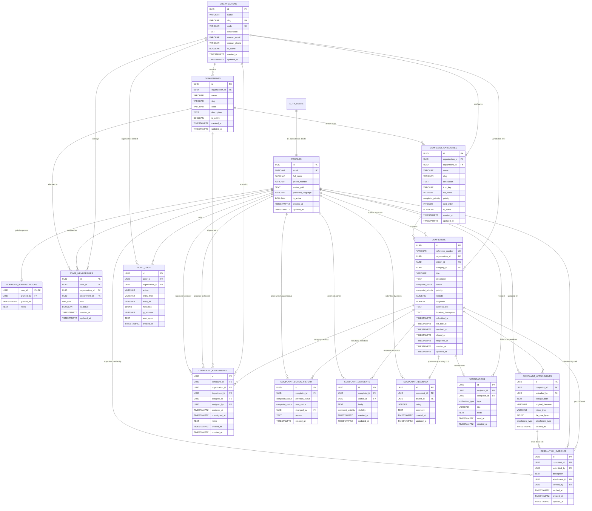

# CivicFix Database Entity Relationships Specification

**Document Version:** 2.0.0  
**Phase:** Day 4 — Production-Minded Database Architecture, PostgreSQL Schema, Migrations, RLS & Seed Data  
**Status:** Approved & Implemented Baseline  

---

## 1. Visual Entity-Relationship Diagram (Mermaid ER)

The following diagram represents the 14 core relational entities, Supabase Auth user integration, and audit boundaries implemented in [database/migrations/](file:///c:/Users/NARENDRA/OneDrive/Desktop/civicfix/database/migrations).

---

## 2. Foreign Key Deletion Policy Matrix

In a civic reporting system, arbitrary `CASCADE` deletions can destroy legal audit trails, evidence, and municipal accountability. The CivicFix deletion policies are designed with deliberate preservation:

| Source Entity | Foreign Key Column | Target Entity | On Delete Action | Architectural Justification |
| :--- | :--- | :--- | :--- | :--- |
| `profiles` | `id` | `auth.users(id)` | `CASCADE` | If a Supabase Auth user is permanently purged from Auth, their base profile shell is removed. |
| `platform_administrators` | `user_id` | `profiles(id)` | `CASCADE` | If user profile is deleted, superuser status automatically revokes. |
| `departments` | `organization_id` | `organizations(id)` | `RESTRICT` | An organization with established municipal departments cannot be accidentally dropped. |
| `staff_memberships` | `user_id` | `profiles(id)` | `CASCADE` | Deleting a user purges their internal employment record. |
| `staff_memberships` | `organization_id` | `organizations(id)` | `RESTRICT` | Cannot delete an organization while staff contracts exist. |
| `staff_memberships` | `department_id` | `departments(id)` | `SET NULL` | If a department is reorganized/dissolved, staff remain in the parent organization unassigned. |
| `complaint_categories` | `organization_id` | `organizations(id)` | `CASCADE` | If an organization is decommissioned, its custom categories are cleaned up. |
| `complaint_categories` | `department_id` | `departments(id)` | `SET NULL` | If a department dissolves, category defaults route to unassigned municipal queue. |
| `complaints` | `organization_id` | `organizations(id)` | `RESTRICT` | Active or historical civic complaints prevent accidental deletion of a city ward/body. |
| `complaints` | `citizen_id` | `profiles(id)` | `RESTRICT` | Citizen cannot purge their profile if active complaints require historical accountability. |
| `complaints` | `category_id` | `complaint_categories(id)` | `RESTRICT` | Cannot delete a civic category while open complaints depend on its classification. |
| `complaint_attachments` | `complaint_id` | `complaints(id)` | `CASCADE` | If a draft/invalid complaint is purged, its photo metadata records are cleared. |
| `complaint_attachments` | `uploaded_by` | `profiles(id)` | `RESTRICT` | Uploader identity must be preserved for audit accountability. |
| `complaint_assignments` | `complaint_id` | `complaints(id)` | `RESTRICT` | Delegation history must remain intact for municipal dispute resolution. |
| `complaint_assignments` | `assigned_to` | `profiles(id)` | `RESTRICT` | Prevents deleting staff accounts with pending or historical assignments. |
| `complaint_status_history`| `complaint_id` | `complaints(id)` | `RESTRICT` | Immutable status transition records cannot be orphaned or deleted. |
| `complaint_comments` | `complaint_id` | `complaints(id)` | `CASCADE` | Discussion comments belong to complaint lifecycle; purge with ticket if complaint is pruned. |
| `complaint_comments` | `author_id` | `profiles(id)` | `RESTRICT` | Author of comment or internal note cannot be deleted while messages persist. |
| `resolution_evidence` | `complaint_id` | `complaints(id)` | `RESTRICT` | Proof-of-work resolution records are legal municipal assets; cannot be dropped. |
| `resolution_evidence` | `attachment_id` | `complaint_attachments(id)`| `SET NULL` | If attachment reference is unlinked, text resolution description remains. |
| `complaint_feedback` | `complaint_id` | `complaints(id)` | `RESTRICT` | Citizen rating and service review cannot be pruned. |
| `notifications` | `recipient_id` | `profiles(id)` | `CASCADE` | In-app alerts are transient user data; purge when profile is deleted. |
| `notifications` | `complaint_id` | `complaints(id)` | `SET NULL` | If a ticket is archived, notification remains as historical alert. |
| `audit_logs` | `actor_id` | `profiles(id)` | `SET NULL` | DPDP compliance: if user invokes "Right to be Forgotten", audit records preserve action with anonymized actor. |
| `audit_logs` | `organization_id` | `organizations(id)` | `SET NULL` | Governance event stays in system even if organizational restructure occurs. |

---

## 3. Cardinality & Multiplicity Rules

1. **One-to-One (1:1):**
   * `auth.users` ↔ `profiles`: Each authenticated identity has exactly one application profile.
   * `complaints` ↔ `complaint_feedback`: Each complaint accepts at most one feedback record per citizen (`UNIQUE (complaint_id, citizen_id)`).
   * `complaints` ↔ Active `complaint_assignments`: At any moment in time, a complaint can have at most one active assignee (`WHERE unassigned_at IS NULL`).

2. **One-to-Many (1:N):**
   * `organizations` → `departments`: An organization has 0 to N departments.
   * `organizations` → `complaints`: An organization manages 0 to N civic complaints.
   * `complaints` → `complaint_attachments`: A complaint can have 1 to 5 uploaded photos.
   * `complaints` → `complaint_status_history`: A complaint accumulates 1 to N immutable lifecycle state transitions.
   * `complaints` → `complaint_comments`: A complaint thread accumulates public citizen updates and internal notes.

3. **Many-to-Many (M:N) Normalized Relationships:**
   * `profiles` ↔ `organizations`: Linked via `staff_memberships` table with specific organizational role (`STAFF`, `SUPERVISOR`, `ORG_ADMIN`).
   * A citizen user may have memberships across multiple organizations or serve as staff in one and citizen in another without duplicating identity profiles.
